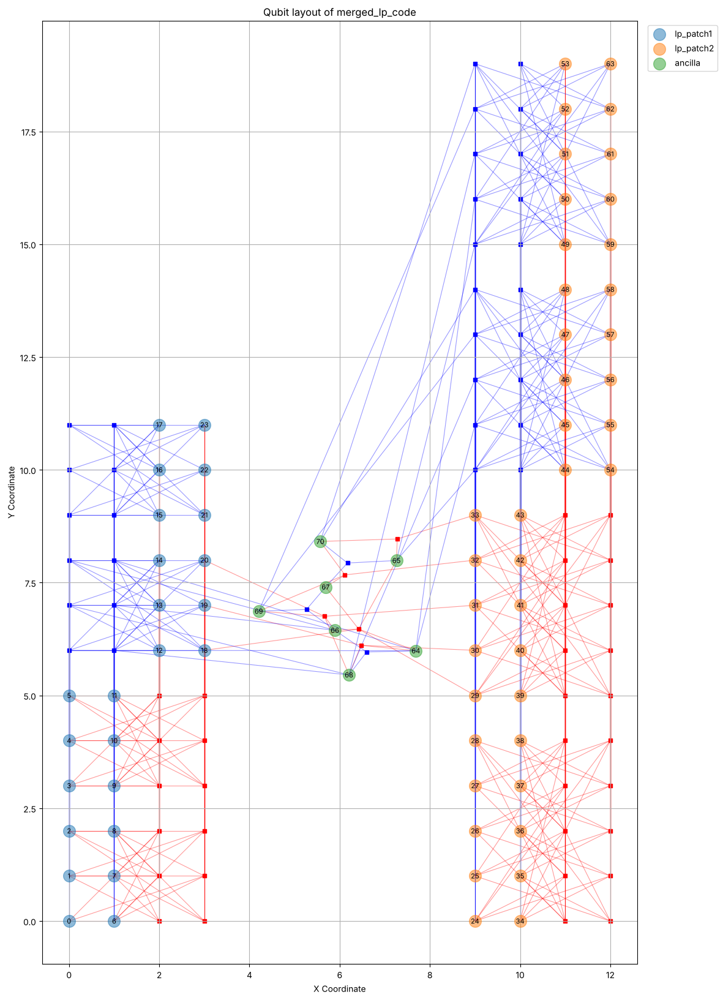

# qLDPC-surgery-sim

Python code for building CSS qLDPC codes, merging code patches by surgery, and generating Stim circuits for memory and surgery.

- **Codes:** surface, rotated surface, hypergraph product (HGP), lifted product (LP), and bivariate bicycle (BB) codes, with distance computed by integer programming.
- **Surgery:** logical XX measurement between two code patches, through
  - an ancilla graph ([arXiv:2410.03628](https://arxiv.org/abs/2410.03628), [arXiv:2410.02213](https://arxiv.org/abs/2410.02213)),
  - an HGP ancilla code (high-rate surgery, [arXiv:2510.08523](https://arxiv.org/abs/2510.08523)).
- **Circuits:** Stim circuits for memory and surgery under phenomenological noise, and a memory circuit under circuit-level noise.
- **Fault analysis:** the minimum-weight fault that causes a logical error without triggering any detector, found by integer programming.
- **Visualization:** qubit and check layout of a code patch or a merged code.

## Layout

```
core/       Qubit, Check, CSS code classes, code patches
surgery/    patch merging and circuit scheduling
analysis/   logical fault analysis
viz/        visualization of code patches
examples/   Jupyter notebooks
```

## Installation

Tested with Python 3.13.

```bash
git clone https://github.com/String137/qLDPC-surgery-sim.git
cd qLDPC-surgery-sim
pip install -e .
```

To run the example notebooks, also install Jupyter (`pip install jupyter`).

Code distances are computed with CPLEX through `docplex`. The `cplex` package on PyPI is the Community Edition, which limits problem size, so larger codes need a full CPLEX installation.

## Usage

Example notebooks are in `examples/`.

| Notebook | Contents |
|---|---|
| `codes.ipynb` | Building codes |
| `merged_code.ipynb` | Merging code patches |
| `memory_circuit.ipynb` | Memory and surgery circuits under phenomenological noise |
| `circuit_level.ipynb` | Memory circuit under circuit-level noise |

Example: logical XX measurement between two LP codes through an ancilla graph (shortened; the full code is in `examples/merged_code.ipynb` and `examples/memory_circuit.ipynb`).

```python
...
lp_patch1 = LPCodePatch(css=lp1, patch_name="lp_patch1")   # [[24,8,3]]
lp_patch2 = LPCodePatch(css=lp2, patch_name="lp_patch2")   # [[40,8,5]]
anc = AncillaGraph(G, patch_name="ancilla", type="X")

X1 = lp_patch1.get_logical_representative("X", 6)
X2 = lp_patch2.get_logical_representative("X", 1)
merged_code = MergedCodeWithGraph(lp_patch1, lp_patch2, anc, X1=X1, X2=X2)
...
visualize(merged_code)

p = 1e-3
scheduler = SurgeryCircuitScheduler(merged_code, 3, 5, 3, p, p)   # pre / merge / post rounds
cb = CircuitBuilder(scheduler.build())
cb.build()
cb.add_detectors()

analyzer = SurgeryLogicalFaultAnalyzer(ErrorSimulator(cb.circuit), merged_code, cb)
e = analyzer.find_min_weight(verbose=False)
print(int(e.sum()))   # 3
```


