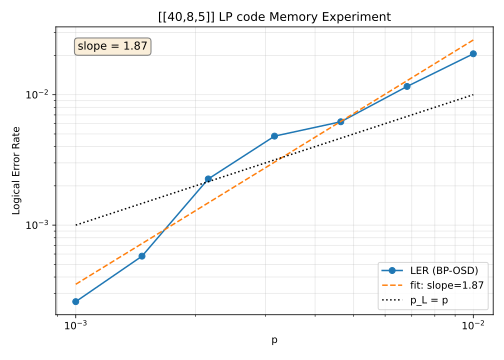

# [[40,8,5]] LP code Memory Experiment

- BpOsd방식 사용
- ``
decoder = self.decoder_cls(
            self.H,
            channel_probs=self.probs,
            bp_method='product_sum',
            osd_method='osd_cs',
            osd_order=5,
        )
``
- min_sum은 product_sum의 빠른 버전(근사)
- min_sum 썼을 때 값이 많이 튀어서 오래걸리지만 product_sum 씀

- phenomenological error model
- EC round 5짜리 (X,Z check meas 5번 반복)
- 처음과 끝에 X check meas 추가.