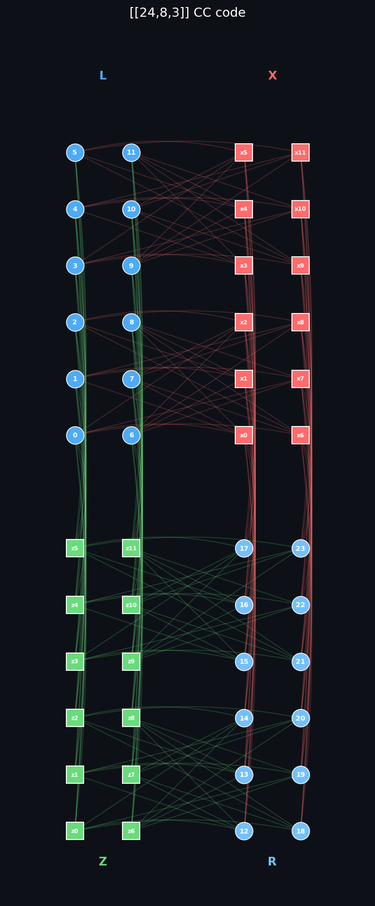

# LP Code

## Configuration

For seed matrices $H_a$ and $H_b$, with shape $(r_a,c_a)$ and $(r_b,c_b)$, respectively, the LP code is defined as

$$H_X=\left(\begin{array}{c|c}H_a\otimes_\mathcal{R} I_{r_b}& I_{r_a}\otimes_\mathcal{R} H_b\end{array}\right)$$
$$H_Z=\left(\begin{array}{c|c}I_{c_a}\otimes_\mathcal{R} H_b^*& H_a^*\otimes_\mathcal{R} I_{c_b}\end{array}\right)$$

where $H^*$ is the conjugate transpose of $H$.

Total qubit number: $c_ar_b+r_ac_b$
$$\mathcal{R}=\mathbb{F}_2[x]/(x^p+1)$$

For the left sector ($c_ar_b$), arrange them in a $c_a\times (r_b\cdot p)$ grid.

For the right sector ($r_ac_b$), arrange them in a $r_a\times (c_b\cdot p)$ grid.

There are total $r_a\times (r_b\cdot p)$ $X$ checks and $c_a\times(c_b\cdot p)$ $Z$ checks.

